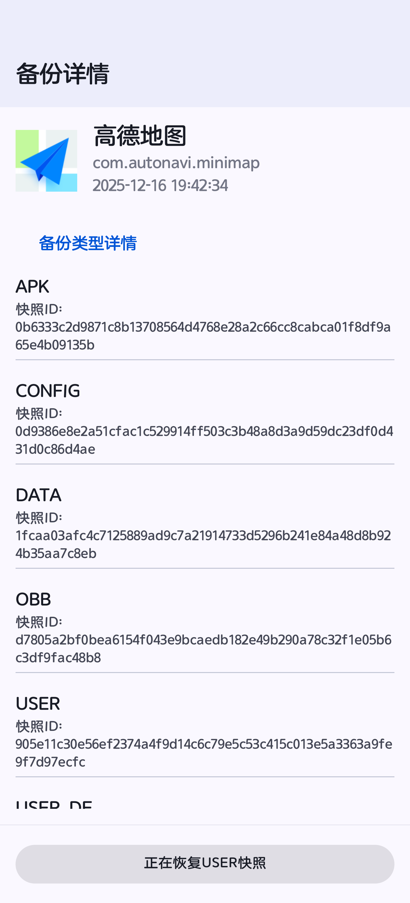
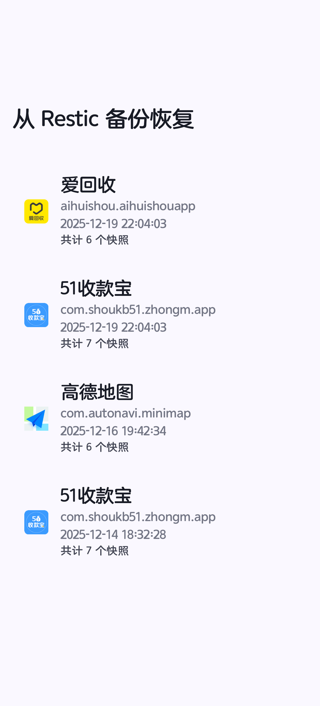
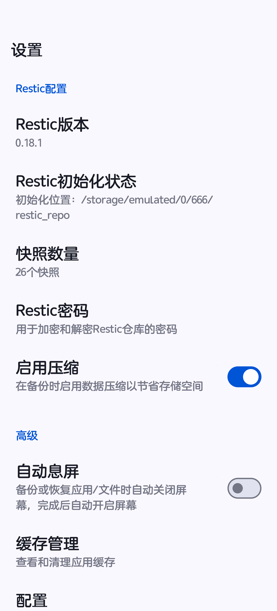

<div align="center">  

<span style="font-weight: bold"> <a href="./README.md"> 中文 </a> | <a href="./README_en.md"> English </a> </span>  

  

<h1 align="center">DataBackup Revived</h1>  

**A better, more powerful Android backup tool.** Automatic encrypted backups for stronger security, fully migrated to rustic (restic), native **incremental backup** support — faster and more time-efficient (**e.g., WeChat incremental backups without full re-backups**), while saving 60–90% storage space.

[](https://github.com/543069760/Android-DataBackup-S3/releases)  
[](./LICENSE)  
[](https://github.com/543069760/Android-DataBackup-S3/releases)

</div>  

> ℹ️ **No external Restic binary required.** Local backup/restore is powered by the Rust `rustic_core` library (a Rust implementation compatible with the restic repository format), compiled into `librustic.so` shipped with the app and invoked directly via JNI. **No more downloading, installing, or managing a standalone Restic Android CGO binary** — the upstream binary's DNS resolution and dynamic linking issues on Android are gone for good. See [Native JNI Migration](#native-jni-migration-rustic-jni-branch).

## Features

* :deciduous_tree: **Root required. Supports [Magisk](https://github.com/topjohnwu/Magisk), [KernelSU](https://github.com/tiann/KernelSU) and [APatch](https://github.com/bmax121/APatch)**
* :cyclone: **Multi-user support (multi-user tabs in both backup and restore lists, including work-profile/clone apps)**
* :cloud: **Supports multiple cloud storage protocols**
* :sunglasses: **Data integrity guaranteed**
* :zap: **Blazing fast (fd streaming backup — tar stdout piped directly into rustic, nothing hits disk)**
* :sunny: **Simple and easy to use**
* :sparkles: **Supports multi-version backups**
* :rose: **Local backup powered by built-in `rustic_core` (JNI, restic-compatible repository) block-level deduplication**
* :electric_plug: **No external binary — `rustic_core` is compiled into `librustic.so` and called via JNI**
* :rocket: **Integrated libsu for an enhanced root experience**

## Version Comparison

### Cloud Storage Protocol Support

| Feature                          | Old (DataBackup) | New (DataBackup Revived 3.0.0)                          |  
|----------------------------------| --- |----------------------------------------------------------|  
| **Local storage / USB OTG**      | ✅ Supported | ✅ **Block-level dedup (JNI rustic, done)**               |  
| **AWS S3 (Minio/Rustfs compatible)** | ❌ Not supported | ✅ **Block-level dedup (JNI rustic, done)**           |  
| **Tencent COS**                  | ❌ Not supported | ✅ **Block-level dedup (JNI rustic, done)**               |  
| **Aliyun OSS**                   | ❌ Not supported | ❗ **Block-level dedup (JNI rustic, WIP)**                |  
| **HuaWei OBS**                   | ❌ Not supported | ❗ **Block-level dedup (JNI rustic, WIP)**                |  
| **FTP**                          | ✅ Supported | ✅ **Block-level dedup (JNI rustic over librclone, done)** |  
| **SFTP**                         | ✅ Supported | ✅ **Block-level dedup (JNI rustic over librclone, done)** |  
| **WebDAV**                       | ✅ Supported | ✅ **Block-level dedup (JNI rustic, done)**               |  
| **SMB/CIFS**                     | ✅ Supported | ✅ **Block-level dedup (JNI rustic over librclone, done)** |

> Aliyun OSS, HuaWei OBS: being adapted progressively — stay tuned.

### Backup Architecture Evolution

| Feature | Old | New (Done)                               |  
| --- | --- |------------------------------------------|  
| **Local backup engine** | tar+zstd compression only | **rustic block-level incremental dedup (JNI, no binary)** |  
| **Data staging** | Compressed archives written to disk first | **fd streaming: tar stdout → pipe → rustic, nothing hits disk** |  
| **Root** | Custom implementation | **libsu integration**                    |  
| **Storage efficiency** | Linear growth | **60–90% space savings**                 |  
| **Encryption** | None | **AES-256 encryption**                   |  
| **Incremental backup** | Not supported | **Natively supported**                   |  
| **Version management** | File overwrite | **Snapshot-based versioning**            |  
| **APK backup (local/cloud)** | Compression only | **rustic incremental dedup (fd streaming)**     |  
| **App data backup (local/cloud)** | Compression only | **rustic incremental dedup (fd streaming)**     |  
| **File/media backup (local/cloud)** | Compression only | **rustic incremental dedup (fd streaming)** |  

### Technical Changes

| Item | Old                      | New |  
| --- |--------------------------| --- |  
| **Package name** | `com.xayah.databackup.*` | `com.xayah.databackup.revived.*` |  
| **Version** | 2.x.x                    | **3.0.0** (rustic-based block-level dedup) |  
| **Root framework** | Custom root service      | **libsu integration** |  
| **Backup engine** | Compression only         | **Streaming pipeline: uncompressed tar (piped) + rustic block-level dedup & encryption** |  
| **Restic/rustic runtime** | None                     | **In-process `rustic_core` via JNI (`librustic.so`)** |  

### 🏗️ Streaming Backup Architecture

Raw data → **uncompressed** `tar` (stdout) → **anonymous pipe fd** → **rustic block-level dedup (JNI, `createSnapshotFromFd`)** → repository

- **Packing layer** — APK/data/media is streamed as an **uncompressed** `tar` stream into a pipe to maximize dedup efficiency; tar record size, pipe capacity, and the rustic read buffer are all aligned to **1MB**, with pipe growth via native `fcntl(F_SETPIPE_SZ)` (guarded to API 30+).
- **rustic dedup layer** — performs block-level dedup, AES-256 encryption, and snapshot writing directly on the fd — **nothing ever touches disk** (no intermediate `apk.tar`/`media.tar`); this holds for local and cloud, app and media backup paths alike. Only small config files such as `package_restore_config.json`/`media_restore_config.json` still go through file-path snapshots.
- **Cancellation & progress** — fd streams support active cancellation via `cancelFd`; the UI shows live throughput and cumulative transferred bytes (fd streams have no known total, so no percentage).
- **Snapshot tag format** — `user_${userId}-${packageName}-${timestamp}-${type}` (`type` ∈ `apk`/`user`/`media`/`config`, etc.). The `user_` prefix is required by `ResticShared.parseAppsDb` — do not omit it.

> ✅ By avoiding both compression and disk staging before dedup, rustic identifies and eliminates redundant blocks across backup batches and devices more effectively, while cutting I/O and write amplification.

### 🔄 libsu Integration
- Root is handled via **libsu** for better Magisk/KernelSU/APatch support, improved error handling, and stronger security.

### 📦 Coverage (Local & Cloud, via JNI rustic)
- **APK backup**, **app data backup**, and **file/media backup** all run through the fd-streaming JNI rustic path (identical for local and cloud).
- The backup list displays **blacklisted apps**.
- Restore lists (local + cloud pages) gained a **multi-user tab** aligned with the backup list; the app restore list is grouped per package and shows clone-user IDs; **select-all/invert** is supported and selections survive round-trips to detail pages.
- The restore "Continue" button now performs an **FBE unlock precheck** on the target user with a dialog; snapshot restore falls back across candidate subPath prefixes, staying compatible with legacy staging snapshots created before the default-directory migration.
- Snapshot IDs are no longer shown in list items for a cleaner UI.

### 📊 Technical Metrics

| Feature | Old Backup  | rustic Backup (JNI) |  
| --- |-------| --- |  
| **Storage efficiency** | Basic compression  | **Block-level dedup + compression** |  
| **Incremental backup** | Not supported   | **Natively supported** |  
| **Encryption** | None     | **AES-256 encryption** |  
| **Version management** | File overwrite  | **Snapshot-based versioning** |  
| **Restore granularity** | Batch restore  | **Precise per-app and per-file restore** |  
| **Storage footprint** | Linear growth  | **60–90% space savings** |  
| **Data transfer** | Archive staged to disk, then uploaded | **fd streaming direct, no disk, cancellable** |  
| **Root** | Custom implementation | **libsu integration** |  
| **Backup runtime** | None     | **In-process `rustic_core` via JNI** |  

> **DataBackup Revived is now a modern data management platform featuring local and cloud block-level deduplication (built-in rustic via JNI), fd streaming backup, and libsu integration; migration of the remaining remote protocols to JNI is in progress.**

## Native JNI Migration (`rustic-jni` branch)

> 🎯 **Local backup/restore has been migrated from "invoking an external Restic Android CGO binary" to "calling the Rust `rustic_core` library directly via JNI". The Rust code is compiled into `librustic.so` shipped with the app, completely eliminating the runtime dependency on an external binary.**

### Background & Motivation

Previously, every local backup/restore invoked an external Restic Android CGO binary: the binary had to be distributed/managed separately, every operation forked a child process, and text/JSON output had to be parsed; the upstream binary also suffered DNS resolution and dynamic linking issues on Android. The `rustic-jni` migration replaces it with native in-process integration:

- **`rustic_core`** is pinned to **`0.12.0`** and vendored as a native submodule reference.
- The Rust crate is built as a **static library**, linked into the JNI anchor, and packaged as **`librustic.so`** shipped with the app.
- Local operations **no longer need any external binary or fork a child process** at runtime.
- The repository format remains **restic-compatible** — existing repositories keep working.

### Architecture

```  
Kotlin (Rustic.kt)  
      │  external fun native*  (JNI)  
      ▼  
AIDL (IRemoteRootService) ──► RemoteRootService / RemoteRootServiceImpl  (root process)  
      │  
      ▼  
librustic.so  (JNI anchor rustic.cpp + Rust staticlib)  
      │  
      ▼  
rustic_core (Rust)  ──►  Local / S3 repository (via opendal backend)  
      ▲  
      └── progress callback (bytes/speed/percent) ──► Kotlin onProgress(JJF)V  
```  

- **Rust side** (`source/native/src/main/jni/external/rustic/rustic`):
  - `lib.rs` organizes crate modules (`error`, `jni_bridge`, `jni_progress`, `progress`, `repository`) and enables `#![deny(improper_ctypes_definitions)]`.
  - `jni_bridge.rs` exports `Java_com_xayah_libnative_Rustic_*` symbols.
  - `repository.rs` wraps the full capability set: `init_repository`, `repository_exists`, `validate_repository`, `create_snapshot` (plus a progress variant), `create_snapshot_from_fd` (fd streaming snapshot), `restore_snapshot` (plus a progress variant), `check_repository`, `forget_snapshot`, `prune_repository`, `list_snapshots_db`.
  - `list_snapshots_db` opens the repository, reads all snapshots, and **writes a SQLite `.db` file directly** using statically compiled `rusqlite` (`bundled`): 4 tables + a `v_snapshots_full` view, which Android can query directly via `SQLiteDatabase.openDatabase(...)` → `rawQuery(...)`.

- **fd streaming backup**:
  - On the Kotlin side, `RootService.backupTarToRustic` runs `tar` in the root process (stdout → pipe) and hands the read-end fd to Rust's `create_snapshot_from_fd`; rustic consumes the byte stream and writes the snapshot directly.
  - Three-level 1MB buffer alignment: tar `--record-size`, pipe `F_SETPIPE_SZ` (native fcntl, API 30 guard), and the rustic read buffer.
  - Supports `cancelFd` cancellation; progress callbacks report throughput and cumulative bytes.

- **Progress callbacks**:
  - `progress.rs` defines the JNI-agnostic `RusticProgressCallback` trait, bridging `rustic_core`'s `ProgressBars` via `AndroidProgressBars`; only byte-level progress (`ProgressType::Bytes`) is reported — spinner/counter progress is hidden.
  - Callbacks are throttled to once per second (`PROGRESS_CALLBACK_INTERVAL = 1s`); `finish` reports the average speed for the whole transfer.
  - `jni_progress.rs` caches the `onProgress(JJF)V` method ID and calls back into Kotlin via `attach_current_thread`.

- **Build wiring (CMake + Corrosion)**:
  - `source/native/src/main/jni/CMakeLists.txt` adds the `rustic` subdirectory.
  - `source/native/src/main/jni/rustic/CMakeLists.txt` uses **Corrosion (v0.6.1)** via `FetchContent` + `corrosion_import_crate` to build the Rust static library (`PROFILE release`, `LOCKED`), then links it with `--whole-archive` into the JNI anchor `rustic.cpp` producing `librustic.so`.
  - The `rustic.map` version script exports only `Java_com_xayah_libnative_Rustic_*` symbols.
  - The Cargo release profile enables `lto = true`, `codegen-units = 1`, `panic = "abort"`, `strip = true` for native-grade performance.

- **Kotlin & AIDL layer**:
  - `Rustic.kt` exposes a Kotlin API with backend options (`Map<String,String>`, zipped from two string arrays through JNI).
  - `IRemoteRootService.aidl` exposes the Rustic method family (`getRusticVersion`, `initRusticRepository`, `rusticRepositoryExists`, `validateRusticRepository`, `createRusticSnapshot`, `createRusticSnapshotFromFd`/`backupTarToRustic`, `restoreRusticSnapshot`, `checkRusticRepository`, `forgetRusticSnapshot`, `pruneRusticRepository`, `listRusticSnapshotsDb`, etc.) and delivers progress via `ICallback`.
  - The root process loads the library at startup (`System.loadLibrary("rustic")` + `Rustic.initLogger()`); `RemoteRootServiceImpl` forwards each AIDL call to `Rustic` under `synchronized(lock)`.

### Migration Phases

- **Phase 0** — Pin `rustic_core` to `0.12.0` and vendor the upstream source as the JNI reference.
- **Phase 1** — Build the JNI bridge and bring up capabilities one by one: `get_version` → `init`/`exists`/`validate` → `create`/`restore` (with progress) → `check` → `forget`/`prune` → `list_snapshots_db` writing SQLite directly; add opendal backend-options plumbing.
- **Phase 2** — Wire new JNI symbols into CMake + instrumented tests; AIDL + `RemoteRootService` wiring.
- **Phase 3** — Migrate local **restore** to JNI rustic with progress/plan callbacks; publish the Rust release profile for expected native performance.
- **Phase 4** — fd streaming backup rolled out everywhere: local apps → cloud apps → files/media; three-level 1MB buffer alignment + `F_SETPIPE_SZ` native growth (API 30 guard); `cancelFd` cancellation and live speed/cumulative UI.

### Testing

- **Host-side tests** (`base_test.rs`): repository probe/validate, snapshot create-restore-verify, multi-source snapshots, snapshot with progress, forget/prune, SQLite writing.
- **On-device tests** (`RusticInstrumentedTest.kt`): full lifecycle, plus querying `v_snapshots_full` via `SQLiteDatabase`, covering the new JNI symbols and non-empty `opendal:fs` option plumbing.

## Screenshots – Restic

<div align="center">  

  

  

  

</div>  

## Screenshots – S3

<div align="center">  

  

  

  

  

  

  

</div>  

## More Screenshots

<div align="center">  

  

  

  

</div>  

<div align="center">  

  

  

  

</div>  

## Download

Get the APK from [Releases](https://github.com/543069760/Android-DataBackup-S3/releases).
  
---  

**Original author [XayahSuSuSu](https://github.com/XayahSuSuSu/Android-DataBackup)**:

- PayPal: https://paypal.me/XayahSuSuSu
- Afdian: https://afdian.net/a/XayahSuSuSu

## License

This project is a modified version of [XayahSuSuSu/Android-DataBackup](https://github.com/XayahSuSuSu/Android-DataBackup), licensed under [GNU General Public License v3.0](./LICENSE).